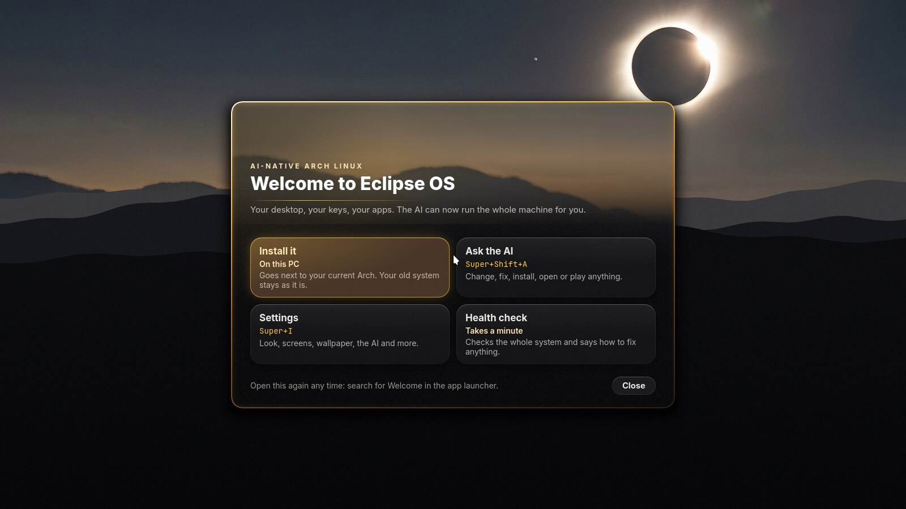
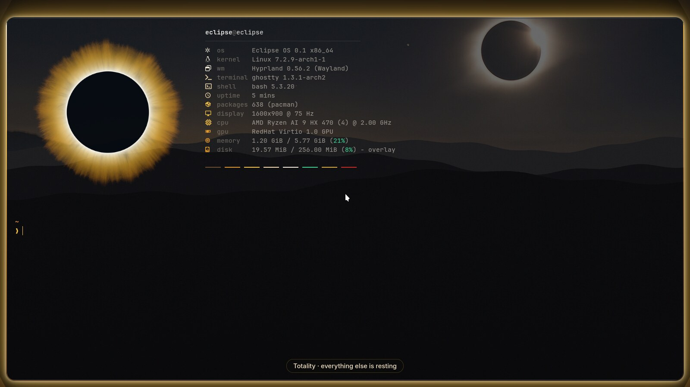
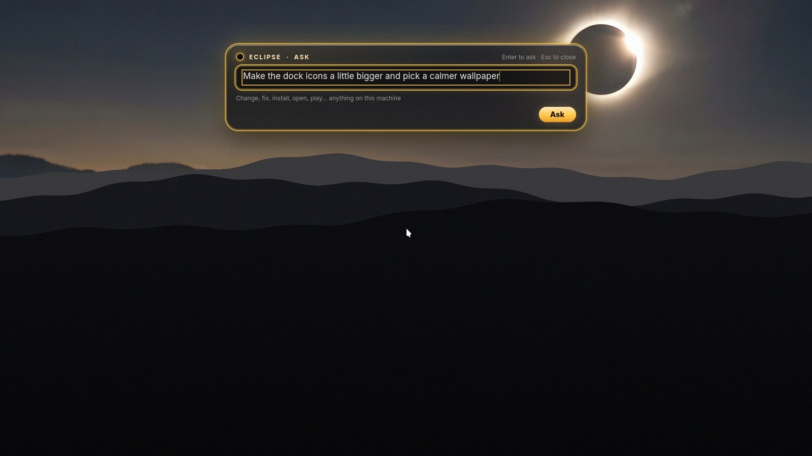
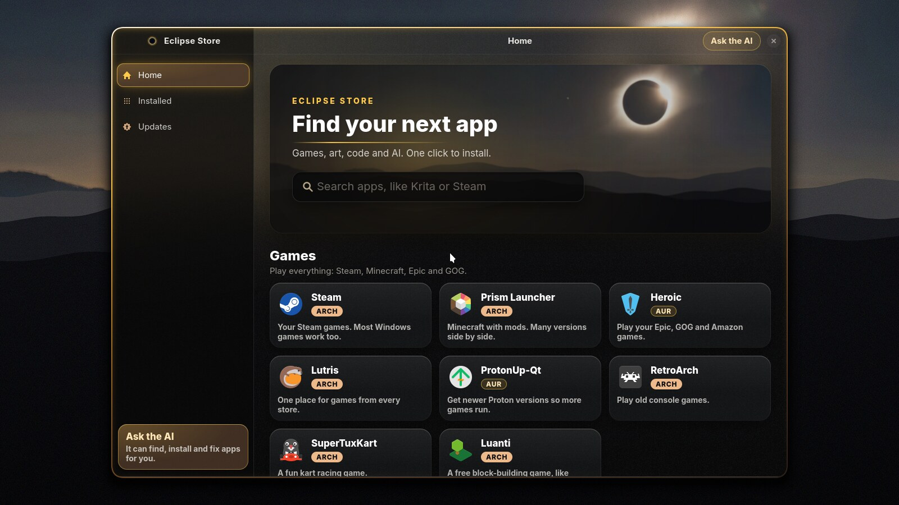
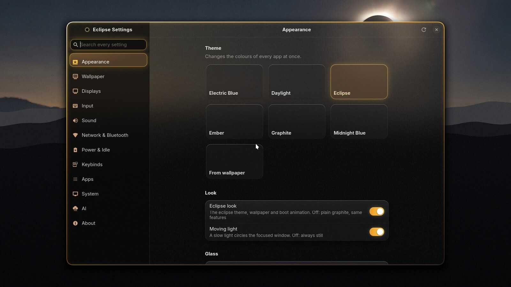
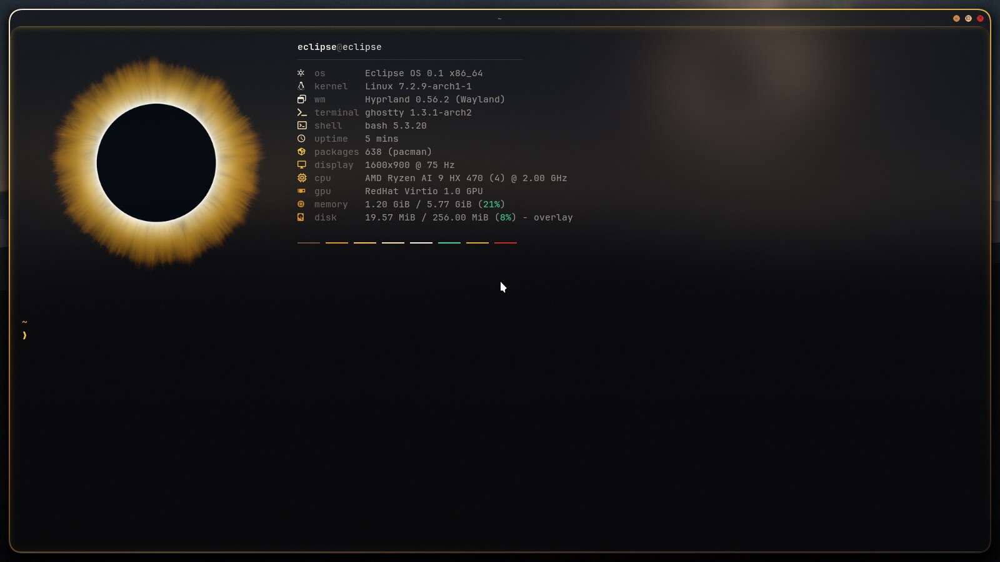

# Eclipse OS

My own spin on Arch Linux. It's built around Hyprland, a dark gold theme, and an AI that can actually control the computer: change settings, install stuff, fix things, open apps.



## What's in it

The thing I like most is Totality. Press Super+G and everything except the window you're using fades out, the moon covers the sun, and the other apps get paused so games and big jobs get the whole PC. Press it again and it all comes back.



You can ask the AI for stuff in plain words, like "make the dock icons bigger" (Super+Shift+A).



### The AI

Eclipse AI (Super+A) is built in. By default it runs a model on your own computer through [Ollama](https://ollama.com), so your chats stay on your PC. The first time you open it, it offers to download the model (about 6.6 GB).

It can run commands, edit files, install apps and change settings, but you stay in charge:

- Before it changes anything, it shows you the exact command and you click yes or no.
- Anything that needs root also asks for your password, through the normal system prompt. The AI can't answer that prompt for you. (If you really want no password, you can turn on "Passwordless admin" in Settings, but then any program running as you can change the whole system.)
- When it changes a file, it keeps the old one next to it (`name.eclipse-ai.bak`). Changes made through Eclipse's own file tools (Settings, or agents over MCP) keep their old version too, and `arc file revert` puts them back.
- If you install Eclipse on a whole drive, it uses btrfs and makes a snapshot before package changes, so you can roll back.

If you have Codex installed and signed in, it also shows up in the model list as "Codex (cloud)". That one is OpenAI's, so your messages leave your computer. It runs its own commands in a sandbox in your home folder without the yes/no cards (you still see each one). Root commands still need your yes and your password.

You can also hook up your own agent, like Claude Code or Codex, through the built-in MCP server (`arclight-mcp`). Those aren't on the ISO, so you install them yourself.

There's also an app store for games and apps, and a settings app with six themes.





## Installing

1. Grab the ISO from [Releases](../../releases).
2. Flash it to a USB stick (4 GB or more). I use [Ventoy](https://www.ventoy.net) but [balenaEtcher](https://etcher.balena.io) works too.
3. Boot from the USB. It goes straight to the desktop.
4. Click "Install it". It can go next to your current system or on its own drive.

The built-in AI needs its model the first time (about 6.6 GB). Optional agents like Claude Code or Codex aren't on the ISO, so you install them yourself after.

## Keys

| Key | What it does |
|---|---|
| Super+G | Totality on/off |
| Super+Space | App launcher |
| Super+A | Eclipse AI |
| Super+Shift+A | Ask the AI |
| Super+I | Settings |

## Building the ISO yourself

You need Arch with `archiso` installed.

```
tools/build-iso.sh
```

The ISO ends up in `out/`. The packages it uses are in `repo/`, and the archiso setup is in `profile/`.

The source for Eclipse OS's own packages (Totality, Ask, the store, the settings app, the installer and the desktop) is in `src/`: one folder per package, each with a `PKGBUILD` and a `root/` folder holding the files exactly as they get installed. To rebuild them into `repo/` after changing something:

```
tools/repack.sh
```

## Third-party software

`repo/` also ships prebuilt packages of other people's software. They keep their own licenses, and their source is upstream:

| Package | License | Source |
|---|---|---|
| yay-bin 13.0.1 | GPL-3.0-or-later | [github.com/Jguer/yay](https://github.com/Jguer/yay/tree/v13.0.1) |
| hyprland-plugin-hyprbars 0.56.2 | BSD-3-Clause | [github.com/hyprwm/hyprland-plugins](https://github.com/hyprwm/hyprland-plugins) (hyprbars) |
| phinger-cursors 2.1 | CC-BY-SA-4.0 | [github.com/phisch/phinger-cursors](https://github.com/phisch/phinger-cursors/tree/v2.1) |

The GRUB theme uses the [Inter](https://github.com/rsms/inter) font (SIL Open Font License 1.1, license included next to the font files).

## License

Eclipse OS is MIT licensed. See [LICENSE](LICENSE). The third-party software above is not covered by it.
